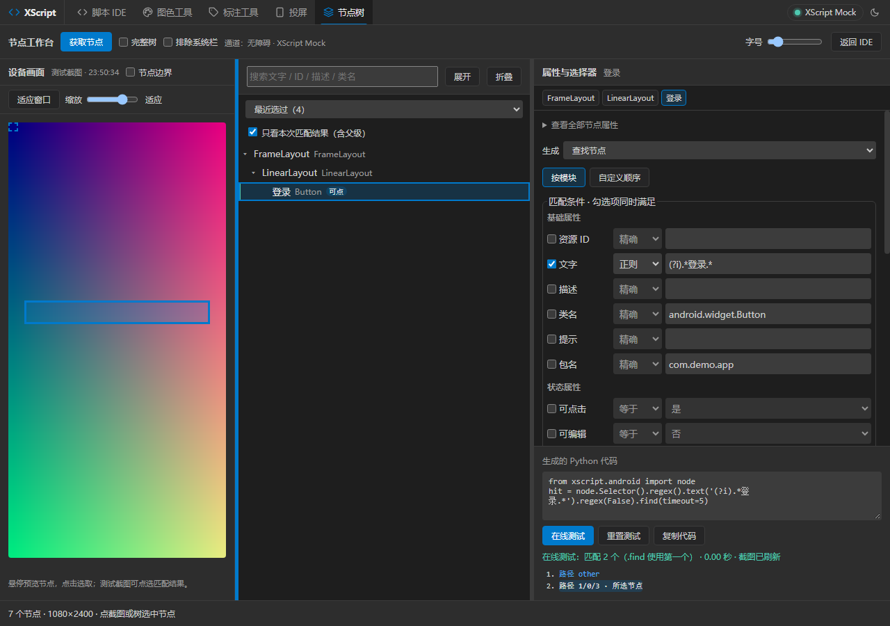

# Web IDE 节点工作台

在 Web IDE 点击 **节点**，工作台会在新标签页打开；也可以直接打开设备的 `/tools/ui/nodes.html`。旧版 APK 尚未带入此页面时，可使用下面的本地预览入口。



## 使用步骤

1. 手机开启 XScript 无障碍服务，或使用已配置的 Root 节点通道。打开待检查的界面；需要截图时同时授权屏幕截取。
2. 点击 **获取节点**。左侧是设备截图，中间是节点树，右侧是属性和选择器。点击截图或节点行即可选中；悬停可预览边框，不改变条件。截图支持 **适应窗口** 和缩放，右栏顶部的节点路径可点击返回父级。两条分隔线可拖动调整列宽，也可聚焦后用左右键调整，双击恢复默认宽度。
3. 在 **匹配条件** 中勾选字段并编辑值。勾选项同时满足；字符串可用精确、包含、正则，状态字段选择是/否，深度和子节点数使用非负整数。
4. 点击 **在线测试**。它在真实设备上重新查找并刷新截图，只查找，不执行生成代码中的点击或长按。显示查询耗时，最多展示 50 个结果，达到上限显示“50 个及以上”；树会只显示匹配路径及其父级，可取消 **只看本次匹配结果** 查看全树。点击结果列表或测试截图中的匹配框，可定位到对应树行并清除遮挡它的搜索，不修改查询条件。
5. 点击 **复制代码**，或从 IDE 打开的工作台中点 **插入到 IDE**。插入保留光标缩进并补充缺少的 import，不会自动保存或运行项目。直接打开工作台时使用复制；原 IDE 已关闭时会提示重新打开。**复制选择器** 只复制单行选择器表达式（如 `node.Selector().text('登录')`），适合贴到已有查询链里。
6. 点击 **重置测试**，清除结果和高亮、退出结果筛选，并恢复当前节点的默认条件、XPath 和关系。已经发出的旧查询返回后不会覆盖重置后的页面。

节点树支持搜索文字、ID、描述、类名、提示；Esc 清空搜索，方向键选取与折叠。**展开 / 折叠** 控制整棵树。**完整树** 包含布局节点，生成 `Selector(1)`；**排除系统栏** 排除 `com.android.systemui` 节点，也会写入生成的查询。标题栏的计数显示当前可见行数和节点总数；选择节点时保留树的滚动位置。主题、字号、列宽、生成类型和最近选过的节点保存在当前浏览器。

常用快捷键：`Ctrl/Cmd + Enter` 在线测试，`/` 聚焦搜索，`Esc` 清空搜索，`↑` / `↓` 在树中移动，`←` / `→` 折叠 / 展开，`Enter` 插入到 IDE。右上角的问号按钮列出同一份说明。

条件默认按基础、状态、结构属性分组。切换 **自定义顺序** 后可拖动每行左侧手柄，或聚焦手柄按 Alt + 上下键排序；顺序保存在浏览器中，调整排列不会更改匹配逻辑。**恢复默认顺序** 可撤销排列偏好。

## 刷新、截图与等待

重新获取节点时，若仍能找到原控件，会保留手动编辑的匹配条件、XPath 和关系。没有编辑的默认条件会根据新快照更新。获取失败时保留已有树和条件，标明旧快照，并暂停在线测试；重新获取成功后恢复测试。

截图上方标明 **节点截图 / 测试截图** 和获取时间。节点截图可选取树节点；测试截图用于定位本次匹配结果。编辑条件或重置后，保留的测试截图会提示重新获取，再继续从画面选取节点。测试截图获取失败时仍显示查询结果列表，但不会把新结果框画在旧图上。

测试中可点 **停止等待**，保留条件并结束浏览器等待。它不会终止已经在设备上开始的查询。节点读取和在线测试请求最多等待 10 秒，截图最多等待 6 秒；超时后提示检查连接并允许重试。手机切换页面后请重新获取节点。

## 匹配与代码

| 匹配方式 | 输入示例 | 含义 |
| --- | --- | --- |
| 精确 | `登录` | 匹配该字段的值，沿用 XScript 运行时规则 |
| 包含 | `A+B` | 包含普通文字 `A+B`，自动转义正则特殊字符 |
| 正则 | `.*登录.*` | Python 正则整段匹配；`.*` 覆盖前后内容 |
| 正则 | `(?i)login` | 忽略大小写；支持 Python 的分组语法 |

正则按设备运行时的 `re.S` / `fullmatch` 规则执行，不使用浏览器正则引擎。非法表达式在线测试会报告 Python 的错误。不同字段的匹配方式互相独立；全部取消勾选时禁止生成、复制和测试，避免无条件查询。

**生成** 支持查找节点、查找全部、等待出现、查找并点击、查找并长按、XPath 查找、点击中心坐标。坐标代码没有节点查询条件，不能在线测试。插入到 IDE 后显示的 **在手机上运行** 会真正运行代码；涉及动作时按钮明确标注“会操作设备”。

**关系定位** 可在字段选择器后添加 `parent`、`child`、`brother`。父级 `1` 是直接父节点；子级 `1` 是第一个，`-1` 是最后一个；兄弟 `0.1` 是下一个，`-0.1` 是上一个。XPath 提供独立可编辑输入；XPath 查找到的节点也可以继续叠加关系（例如 `Selector(xpath=...).parent(1)`），关系和筛选从 XPath 命中节点开始，而不是重新从整棵树开始。

默认条件优先选择唯一的 ID、文字或描述，重复时补充条件；避开时钟等动态文字。只能依赖路径时给出风险注释，并在附近存在更稳的父/子节点时提供 **换成它**。刷新时尝试按语义找回原节点，不会直接选中占据旧路径的其他控件。

## 本地源码预览

无需重新安装 APK，即可用本地页面连接已有 XScript 设备。需要 Node 22 或更高版本。在仓库根目录执行以下 PowerShell 命令，将示例地址替换为手机显示的开发者地址：

```powershell
$env:XSCRIPT_TOKEN = Read-Host '输入 XScript 配对码'
node scripts/preview_nodes.cjs --device http://192.168.1.100:9860
```

打开 `http://127.0.0.1:19860/tools/ui/nodes.html`。终端保持运行，Ctrl+C 停止，结束后可执行 `Remove-Item Env:XSCRIPT_TOKEN` 清除当前终端的环境变量。配对码只放在进程内，不写入仓库。默认端口被占用时使用 `--port 19861`。

设备关闭配对时，无需设置 `XSCRIPT_TOKEN`，直接运行预览命令；如果终端里保留过旧码，先执行 `Remove-Item Env:XSCRIPT_TOKEN -ErrorAction SilentlyContinue`。

预览只监听本机，使用本地 HTML/JS/CSS 和设备的节点、截图、eval 接口。它可读取工程、测试节点，但不转发项目保存、运行或删除请求；要保存/运行项目，请使用设备原生 Web IDE。不要把预览地址当作手机 APK 已更新的证据。

## 与 AScript 参考页的差异

工作台参考 AScript 的独立三栏布局、截图联动、搜索折叠、属性选择器、关系、XPath、测试与复制流程，并使用 XScript 自己的接口重新实现。

- XScript 使用设备当前的无障碍或 Root 通道，支持简单 / 完整树；不冒用 AScript 的 HID、数字助手、Shizuku 模式编号。
- 已加入真实设备只读测试、精确/包含/正则逐字段混用、路径稳定性建议、跨页插入 IDE、旧响应作废和无 APK 重建预览；支持截图缩放、悬停预览、父级路径、结果定位、保留手动条件及停止等待。
- 条件支持分组与自定义拖拽排序。未加入 AScript 的 HID 控件通道或任意原始选择器表达式执行；可编辑条件和 XPath 之外的自由代码仍在 IDE 中编写。
- 树和截图是快照，刷新和测试不保证同一时刻采集。页面滚动、旋转或切换后应重新获取；结果节点不在树快照中时会提示刷新。

## 常见问题

- 读不到节点：查看底部提示，开启 XScript 无障碍服务或检查 Root 通道；可以点击 **打开手机无障碍设置**。
- 没有截图：先授权屏幕截取；节点树仍然可用。
- 设备断连或响应超时：检查手机开发者地址和网络后重新获取；上次条件仍保留，旧快照不会被当作新结果。
- 新标签页未打开：允许该站点打开新标签页，或直接访问工作台路径。
- 预览返回 401：配对码可能已改变，更新环境变量并重启预览。
- 找到多个结果：增加 ID、类名、包名或其他稳定字段；`.find()` 使用第一个结果，不能把多匹配当作唯一定位。
